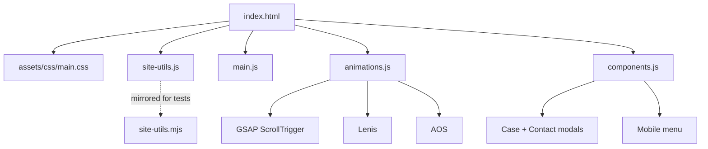

# Architecture

**Analyzed:** 2026-07-14

## Overview

Single-page marketing site (`index.html`) with a secondary `blog-post.html`. Behavior split across classic scripts loaded in order; CSS owns section ambience and responsive layout.

## Page flow (homepage)

1. Header (fixed) + mobile overlay
2. Hero (video + CTAs + product logos)
3. Clientes → Sobre → Missão → Mobile strategist → Serviços
4. Portfolio (horizontal rail / pin on desktop)
5. Produtos (bento)
6. **Aplicações / IA** (ex-Marketing) — two-column
7. Blog insights → Contato CTA → Footer
8. Modals + floating WhatsApp

## Script boot

- Classic `<script src>` tags (no `type="module"` on homepage)
- `components.js` sets `window.__wvBooted = true`
- `app.js` exists for optional module path — **do not** switch homepage to it without verifying GSAP globals

## Critical interactions

- Portfolio: `#portfolio-rail` + `#portfolio-horizontal`; mobile drag scroll; desktop GSAP pin
- Modals: `.open-modal` / `.open-case`; `html.modal-open`
- Ambient glow: section `::after` with bilateral bleed (overflow visible)

## Data

- No backend; contact form builds WhatsApp URL via `WVSiteUtils`
- Case cards use `data-case-*` attributes for modal content
