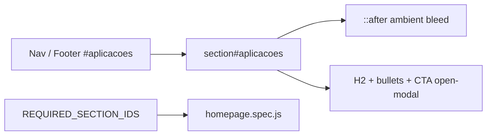

# Aplicações e Sistema com IA — Design

**Spec**: `.specs/features/aplicacoes-sistema-ia/spec.md`  
**Status**: Approved (agent discretion — requisitos claros)

---

## Architecture Overview

Surgical content/anchor swap in the existing two-column section. No new JS modules. CSS selector rename `#marketing` → `#aplicacoes`. Constants in `site-utils.mjs` drive e2e.

---

## Code Reuse Analysis

| Component | Location | How to Use |
| --- | --- | --- |
| Two-column section markup | `index.html` `#marketing` | Rename + rewrite copy |
| Glow pattern | `main.css` `#marketing::after` | Rename selectors; keep values |
| Modal CTA | `.open-modal.magnetic` | Keep behavior |
| Section constants | `site-utils.mjs` | `marketing` → `aplicacoes`; add nav hash |

### Concerns mitigation

- Portfolio untouched
- Classic scripts untouched
- Glow: only rename id; do not change overflow model

---

## Components

### 1. Section Aplicações

- **Purpose**: Comunicar oferta de apps/sistemas com IA
- **Location**: `index.html` (após `#produtos`, antes `#blog`)
- **Content (PT)**:
  - Eyebrow: `Inteligência Aplicada`
  - H2: `Aplicações e` + lime `Sistema com IA.`
  - Body: premium B2B sobre engenharia de aplicações e sistemas com IA no núcleo
  - Bullets: Automação inteligente; Agentes & copilotos; Sistemas preditivos & analíticos
  - CTA: `PROJETAR COM IA` (`.open-modal`)
  - Decor badge: `Camada de Inferência` (ex-Monitor de ROI)
  - Image: reutilizar asset técnico existente (`programming.jpg`) com alt atualizado
- **CSS**: `#aplicacoes` + `#aplicacoes::after`; mobile media query selector update

### 2. Navigation links

- Desktop + mobile + footer: label `Aplicações` → `#aplicacoes`
- Insert after Produtos (antes de Projetos) para coerência de oferta

### 3. Global messaging

- Meta description + hero paragraph: trocar pilar "marketing de conversão" por sistemas/IA

---

## Data Models

N/A (static content)

---

## Decisions

| Topic | Choice | Rationale |
| --- | --- | --- |
| New id | `#aplicacoes` | Semântico; churn controlado |
| Nav label | Aplicações | Cabe no tracking uppercase |
| Image | `programming.jpg` | Tom engenharia; já no CDN da marca |
| CTA text | PROJETAR COM IA | Premium, action-oriented |
