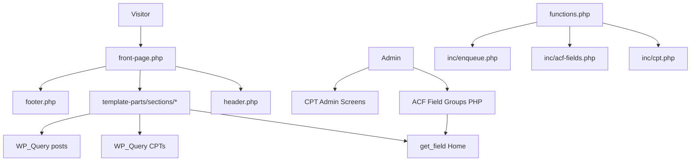

# WordPress Theme + ACF Free — Design

**Spec**: `.specs/features/wordpress-theme-acf/spec.md`  
**Status**: Approved

---

## Architecture Overview

Standalone classic WordPress theme (`wvtodoz-theme/`) that ports the static homepage into PHP templates. Content splits into:

1. **Front Page ACF fields** (ACF free) — one-off section copy/media
2. **Custom Post Types** — repeating cards (cases, produtos, clientes, serviços)
3. **Native Posts** — Insights/blog cards
4. **WP Menus + Custom Logo** — chrome (no Options Page)



---

## ACF Free Constraints (enforced)

| Forbidden (Pro) | Free alternative used |
| --------------- | --------------------- |
| Options Page | Fields on Front Page + Customizer logo + Menus |
| Repeater | CPTs (`wv_case`, `wv_produto`, `wv_cliente`, `wv_servico`) |
| Flexible Content | Fixed section template-parts |
| Gallery | Single image fields or featured image |
| Clone | Duplicated field keys only where needed |

---

## Code Reuse Analysis

| Component | Location | How to Use |
| --------- | -------- | ---------- |
| `main.css` | `assets/css/main.css` | Copy into theme `assets/css/` |
| JS suite | `assets/js/*.js` | Copy + enqueue in footer (classic scripts, not ES modules) |
| Images/video | `assets/img`, `assets/video` | Copy into theme assets |
| Markup | `index.html` sections | Split into `template-parts/sections/*.php` |
| Fallback copy | Static HTML strings | `inc/defaults.php` when ACF empty |

---

## Theme File Map

```
wvtodoz-theme/
├── style.css                 # Theme header only (+ optional thin overrides)
├── functions.php             # Bootstraps inc/*
├── front-page.php            # Homepage composer
├── header.php
├── footer.php
├── index.php                 # Fallback blog loop
├── single.php                # Insight single
├── page.php
├── README.md
├── inc/
│   ├── setup.php             # theme supports, menus, image sizes
│   ├── enqueue.php           # CSS/JS/CDN
│   ├── cpt.php               # CPT registration
│   ├── acf-fields.php        # acf_add_local_field_group
│   ├── helpers.php           # wv_get_field, logo URL, WhatsApp
│   └── defaults.php          # static fallbacks
└── template-parts/
    ├── modals.php
    └── sections/
        ├── hero.php
        ├── clientes.php
        ├── sobre.php
        ├── missao.php
        ├── mobile-bridge.php
        ├── servicos.php
        ├── portfolio.php
        ├── produtos.php
        ├── aplicacoes.php
        ├── blog.php
        └── contato.php
```

---

## Components

### Theme bootstrap (`functions.php` + `inc/setup.php`)

- **Purpose**: Register supports (`title-tag`, `post-thumbnails`, `custom-logo`, HTML5), nav menus `primary` / `mobile` / `footer`
- **Dependencies**: WordPress 6.x+

### Enqueue (`inc/enqueue.php`)

- **Purpose**: Load fonts, Tailwind CDN + inline config, Phosphor, AOS CSS/JS, GSAP + ScrollTrigger, Lenis, theme `main.css`, then `site-utils.js` → `main.js` → `animations.js` → `components.js`
- **Dependencies**: CDNs listed in static `index.html`

### CPT registry (`inc/cpt.php`)

| CPT | Slug | UI | Key meta (ACF) |
| --- | ---- | -- | -------------- |
| Cases | `wv_case` | title, editor, thumbnail, page-attributes | category, meta_title, meta_desc, external optional |
| Produtos | `wv_produto` | title, editor, thumbnail, page-attributes | subtitle, highlights (textarea), primary_url, secondary_url, featured (true/false), badge |
| Clientes | `wv_cliente` | title, thumbnail, page-attributes | (logo = featured image) |
| Serviços | `wv_servico` | title, editor, page-attributes | icon_class, accent_html title parts, bullets textarea, cta_label, layout_variant (select), link_url |

### ACF Home field groups (`inc/acf-fields.php`)

Tabs on Front Page:

- **Hero**: badge, eyebrow, title_line_1, title_accent, lead, cta_primary_label, cta_primary_url, cta_secondary_label, video (file), show_product_logos (true/false)
- **Sobre**: title_line, title_accent, lead, stat_1_number, stat_1_label, stat_2_number, stat_2_label, image, cta_primary, cta_secondary_label, cta_secondary_url
- **Missão**: eyebrow, title, support, product_a, product_b, cta_label
- **Mobile Bridge**: title_html (wysiwyg limited) or structured lines + accent word, eyebrow, lead, cta_label
- **Serviços intro**: eyebrow, title_line, title_accent, intro, note, quote_cta; process steps 1–4 (title + desc each)
- **Portfolio intro**: eyebrow, title_line, title_accent, lead, cta_label
- **Produtos intro**: eyebrow, title_line, title_accent, lead
- **Aplicações**: eyebrow, title_line, title_accent, lead, image, chip_kicker, chip_title, benefit_1/2/3, cta_label
- **Contato**: title_before, title_highlight, phone_label, phone_tel, whatsapp_url, wa_float_label
- **Footer**: tagline, address, maps_url, copyright, privacy_url, terms_url, social URLs (fb/ig/li/yt)
- **Modal**: contact_title, contact_title_accent

### Helpers (`inc/helpers.php`)

- `wv_field( $key, $default = '' )` — safe `get_field` with default
- `wv_home_id()` — front page ID
- `wv_logo_url()` — custom logo or remote default
- `wv_whatsapp_url()` — ACF or default wa.me
- Always escape at output sites

---

## Data Models

### Home (Page)

ACF meta keys prefixed `wv_` (e.g. `wv_hero_badge`).

### CPT posts

Standard WP post + ACF meta; `menu_order` for display order.

### Insights

`post` with featured image, title, excerpt, category name as tag.

---

## Security

- Escape: `esc_html`, `esc_attr`, `esc_url`, `wp_kses_post`
- No unauthenticated AJAX write endpoints in MVP (contact form keeps client-side WhatsApp redirect behavior from `components.js`)

---

## Risks & Mitigations

| Risk | Mitigation |
| ---- | ---------- |
| Empty CPT queries look broken | `defaults.php` + README seed instructions |
| Tailwind CDN in production | Same as static site; documented limitation |
| ACF inactive | Guard all `get_field` calls |
| Large hero.mp4 in theme | Copy as-is; optional replace via ACF file field |

---

## Open Questions

None blocking — user specified ACF free architecture and CPTs for repeating content.
