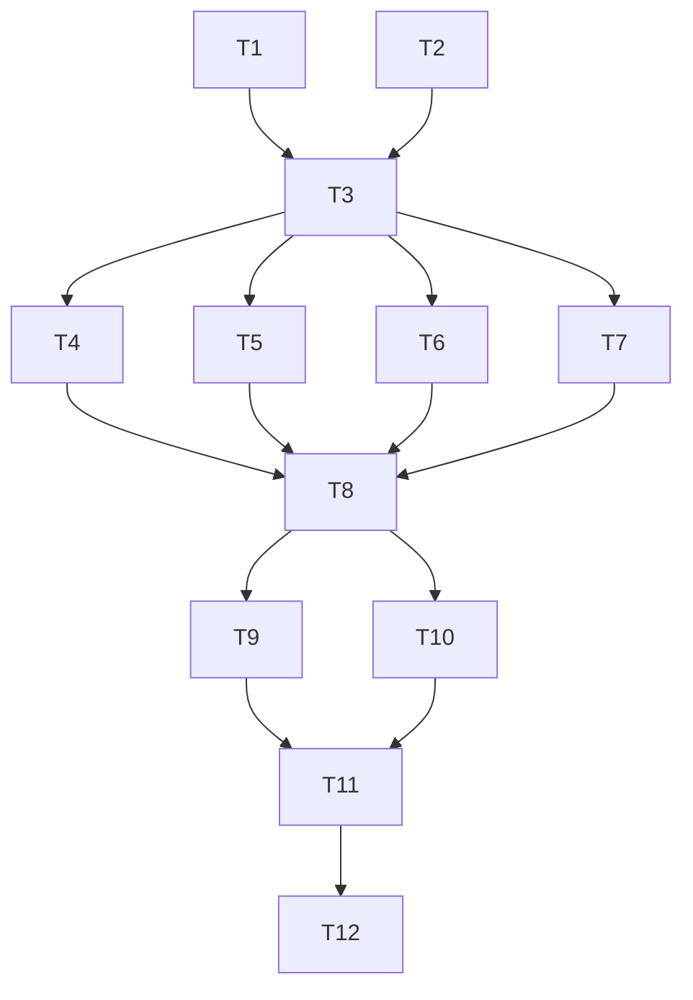

# WordPress Theme + ACF Free — Tasks

**Spec**: `.specs/features/wordpress-theme-acf/spec.md`  
**Design**: `.specs/features/wordpress-theme-acf/design.md`

## Traceability

| Req | Tasks |
| --- | ----- |
| REQ-10 | T1 |
| REQ-11 | T2 |
| REQ-01 | T3 |
| REQ-02 | T4 |
| REQ-04 | T5 |
| REQ-03 | T6 |
| REQ-06 | T7–T9 (escape in templates) |
| REQ-05 | T7–T9 |
| REQ-07 | T3, T8 |
| REQ-08 | T10 |
| REQ-09 | T11 |

---

### T1: Backup static HTML
- **What**: Copy `index.html`, `blog-post.html`, `assets/` + ASSETS.md to `backups/static-v3-20260715/`
- **Done when**: Backup exists; originals untouched
- **Status**: Complete

### T2: Spec-Driven artifacts + project docs
- **What**: Write spec/design/tasks; update PROJECT/ROADMAP/STATE
- **Done when**: Files under `.specs/features/wordpress-theme-acf/` + project docs mention WP theme milestone
- **Status**: Complete

### T3: Scaffold theme shell
- **What**: Create `wvtodoz-theme/` with `style.css`, `functions.php`, `header.php`, `footer.php`, `front-page.php`, `index.php`, `page.php`, `inc/setup.php`
- **Done when**: Theme header valid; menus + custom-logo registered
- **Status**: Complete

### T4: Copy assets + enqueue
- **What**: Copy CSS/JS/img/video into theme; implement `inc/enqueue.php`
- **Done when**: Enqueued deps match static site order
- **Status**: Complete

### T5: Register CPTs
- **What**: `inc/cpt.php` for wv_case, wv_produto, wv_cliente, wv_servico
- **Done when**: CPTs appear in Admin when theme active
- **Status**: Complete

### T6: ACF local field groups
- **What**: `inc/acf-fields.php` — Home tabs + CPT field groups; Portuguese labels; free field types only
- **Done when**: Groups register when ACF active; no Pro field types
- **Status**: Complete

### T7: Helpers + defaults
- **What**: `inc/helpers.php`, `inc/defaults.php`
- **Done when**: Fallbacks match static copy for empty fields
- **Status**: Complete

### T8: Section template-parts (content sections)
- **What**: hero, clientes, sobre, missao, mobile-bridge, servicos, portfolio, produtos, aplicacoes, blog, contato
- **Done when**: `front-page.php` includes all; ACF/CPT wired; output escaped
- **Status**: Complete

### T9: Modals + WhatsApp float in footer
- **What**: `template-parts/modals.php` + WA float using ACF/helpers
- **Done when**: Modals markup present; JS selectors intact
- **Status**: Complete

### T10: single.php + page.php polish
- **What**: Themed single post for insights
- **Done when**: Single post uses header/footer and readable layout
- **Status**: Complete

### T11: README install guide
- **What**: WP + ACF free + Front Page + CPT seeding notes + ACF free limits
- **Done when**: `wvtodoz-theme/README.md` complete
- **Status**: Complete

### T12: Commit + push
- **What**: Commit theme, specs, backup; push to origin
- **Done when**: Commit hash known; push status reported
- **Status**: In progress

---

## Execution diagram

## Parallelism

- After T3: T4, T5, T6, T7 can run in parallel
- T8 depends on T4–T7
- T9/T10 after T8
- T11 after T9/T10
- T12 last
